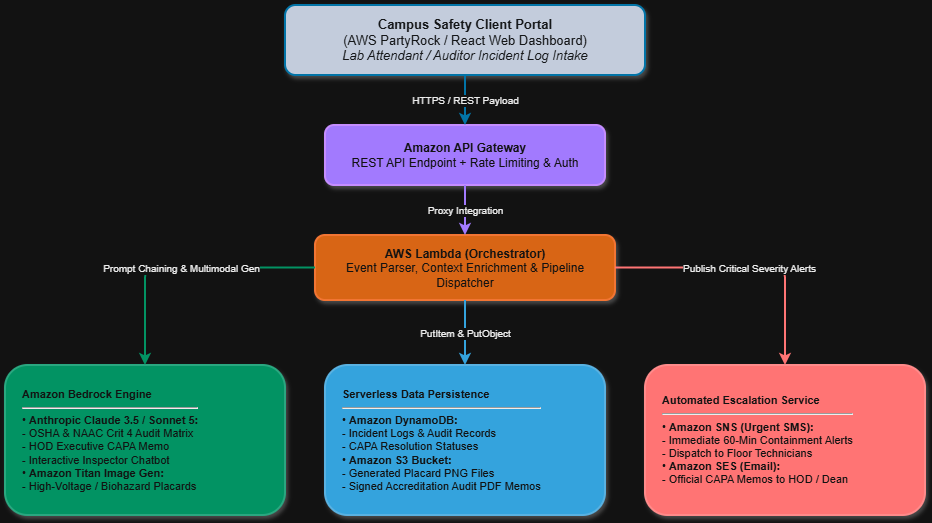

# CampusAccredita – Lab Safety & Compliance Auditor

> An institutional lab compliance and safety auditor built on AWS PartyRock and Amazon Bedrock.

---

## 📌 Problem Statement
Laboratory safety gaps and maintenance issues in universities are often documented only in informal paper logs until an official accreditation inspection happens[cite: 6]. Undocumented faults or expired equipment directly impact institutional ratings under **NAAC Criterion 4** and industrial **OSHA** standards[cite: 6].

---

## 🚀 Key Features
1. **Unstructured Log Ingestion**: Parses raw technician field notes and categorizes risk parameters by facility type.
2. **Accreditation Audit Engine**: Maps hazards to OSHA regulations and NAAC Criterion 4 benchmarks.
3. **Executive CAPA Memos**: Generates formal regulatory escalation memos directed to the Head of Department with a 48-hour checklist.
4. **Hazard Placards**: Synthesizes high-contrast caution placards via Amazon Titan Image Generator for physical bench isolation.
5. **Interactive Auditor Chat**: Context-aware chatbot enabling administrators to query regulatory penalties and remediation workflows.

---

## 🏗 System Architecture

The enterprise production design uses:
- **Client Layer**: PartyRock / React Web Portal
- **API & Routing**: Amazon API Gateway
- **Compute Orchestrator**: AWS Lambda
- **Intelligence Engine**: Amazon Bedrock (Claude 3.5 & Titan Image Generator)
- **Data Persistence**: Amazon DynamoDB & Amazon S3
- **Alert Dispatch**: Amazon SNS (urgent SMS) & Amazon SES (memos)

---

## 🔗 Project Links
- **Live Application**: [PartyRock Web App](https://partyrock.aws/u/swayamshoubin/8ga4yQLi-/CampusAccredita-Lab-Safety-and-Compliance-Auditor)
- **Video Walkthrough**: [YouTube Video](https://youtu.be/Pue-8vZKu1M)
